# LLM Reliability & Evaluation Platform — Technical Understanding and Research Architecture Report

**Project:** University capstone (6-member team) · **Repository:** `llm-reliability-and-evaluation-platform`, branch `fix/evaluation-integrity` (commit `7e0604d`, 2026-11-19) · **Prepared from:** direct inspection and execution of the repository.

> **How to read this report.** Every factual statement carries one of four labels:
>
> - **[Verified]**: checked by reading the code and running it (tests, API calls, browser, or the EXP-001 experiment).
> - **[Design intent]**: stated in code comments or project documents, not independently tested.
> - **[Hypothetical]**: an illustrative example, not a measurement.
> - **[Recommendation]**: the author's opinion about what to do.
>
> All numbers labelled *actual* come from EXP-001: 540 real generations with local models, run on 2026-11-19 (`research/experiments/EXP-001_local_rag_reliability/`). No other numbers in this report are measurements.

## Table of Contents

1. [Executive Overview](#1-executive-overview)
2. [Research Foundations](#2-research-foundations)
3. [Research Questions and Hypotheses](#3-research-questions-and-hypotheses)
4. [System Architecture](#4-system-architecture)
5. [End-to-End Experiment Lifecycle](#5-end-to-end-experiment-lifecycle)
6. [Evaluation Methodology](#6-evaluation-methodology)
7. [Failure Taxonomy](#7-failure-taxonomy)
8. [Experimental Design](#8-experimental-design)
9. [Reproducibility and Data Model](#9-reproducibility-and-data-model)
10. [Current Implementation Audit](#10-current-implementation-audit)
11. [Research Landscape and Related Work](#11-research-landscape-and-related-work)
12. [Architecture and Methodological Risks](#12-architecture-and-methodological-risks)
13. [Visual System Understanding (Figure Index)](#13-visual-system-understanding-figure-index)
14. [Project Roadmap](#14-project-roadmap)
15. [Final Technical Understanding](#15-final-technical-understanding)
- [Glossary](#glossary)
- [References](#references)

---

## 1. Executive Overview

### 1.1 What we are building

We are building **a controlled experimental instrument for measuring how and why LLM applications fail**. It is not a chatbot. The platform:

- runs a fixed set of questions (a *dataset version*) through a model or a RAG pipeline (an *adapter*);
- applies several independent *evaluators* to every answer;
- keeps all the evidence: the prompt, the retrieved passages, the output, each evaluator's verdict and reasoning, and the configuration;
- attaches a rule-based *diagnosis* to each case;
- compares runs only when their configurations make the comparison meaningful.

**[Verified]**

### 1.2 The problem and why it matters

A fluent answer is not necessarily a correct one, and a correct answer is not necessarily supported by the evidence the system retrieved. In a RAG application, at least five failure sources are entangled:

1. **Retrieval** misses the relevant passage.
2. **Generation** ignores or contradicts good evidence.
3. **The answer** is right but phrased so that a strict metric rejects it.
4. **The evaluator** itself is wrong.
5. **The call** crashes.

A single "accuracy" number mixes all five. The cost of the mix is concrete. In EXP-001 **[Verified, actual]**, the same 60 answers from `qwen3:4b-instruct` with top-3 retrieval score:

- **30.0%** under exact match;
- **43.3%** under SQuAD-normalized match;
- **58.3%** under an LLM judge.

The choice of evaluator moved the result by 28 percentage points. That is more than any model or retrieval-depth difference we measured.

### 1.3 Application development vs. systematic reliability evaluation

| Aspect | Typical LLM application development | Systematic reliability evaluation (this platform) |
|---|---|---|
| Goal | A working feature | A defensible measurement |
| Unit of work | A prompt that "looks right" | A versioned dataset × configuration × evaluator set |
| Evidence kept | Final answer, maybe logs | Prompt, retrieved chunks with scores, output, every evaluator result, config snapshot, provenance |
| "Success" | The demo works | The answer passed *named* evaluators, which are reported separately |
| Failure handling | Retry or fix the prompt | Classify, attribute to a pipeline stage, keep visible |
| Comparison | "Feels better" | Same dataset version, controlled variables, paired statistics |
| Repeatability | Not considered | Fingerprints, model digests, repeated runs; determinism is *measured* |

### 1.4 Why the platform is valuable as a research instrument

The value lies in methodological discipline, not in new metrics. Specifically:

- execution success is kept separate from evaluation verdicts;
- every verdict stays attached to its evidence;
- runs are refused if the configuration that would be recorded is not the one that ran;
- evaluator disagreement is surfaced instead of averaged away.

All four properties were verified on the current branch. Several were only made true during this audit, when the defects that broke them were fixed (Section 10.3).

## 2. Research Foundations

Each concept below follows the same pattern:

- **Meaning:** what it is.
- **Importance:** why it matters.
- **How it works:** the working principle.
- **Measurements:** the relevant metrics.
- **Limitations:** what the metrics miss.
- **Platform:** where it lives in the code.

### 2.1 LLM reliability and evaluation

- **Meaning.** Reliability is whether a system's outputs are *correct, supported, consistent and robust* under stated conditions. Evaluation is the measurement procedure.
- **Importance.** LLMs are stochastic, sensitive to prompts, and fluent even when wrong, so a single correct demo says little about reliability.
- **How it works.** Fix the inputs (dataset version), fix and record the configuration, run, apply several evaluators, repeat, and compare under statistical control.
- **Measurements.** Per-evaluator pass rates with intervals, agreement statistics, consistency rates, latency and tokens.
- **Limitations.** Every evaluator is itself an imperfect instrument, and benchmark scores generalise poorly beyond their distribution (Liang et al., 2022).
- **Platform.** `EvaluationRunner` (`evaluation/runner.py`), `ExperimentManager` (`experiments/manager.py`) and `analytics/`.

### 2.2 Retrieval-Augmented Generation (RAG)

- **Meaning.** The model answers using passages retrieved from a corpus at query time (Lewis et al., 2020; survey: Gao et al., 2023).
- **Importance.** RAG grounds answers in specific sources, but adds a second failure point: retrieval.
- **How it works.**
  1. Documents are chunked.
  2. Chunks and the query are embedded.
  3. The top-*k* chunks by cosine similarity are put into a prompt.
  4. The model generates an answer.
- **Measurements.** Retrieval metrics (Hit@K, Recall@K, MRR), answer correctness and faithfulness.
- **Limitations.**
  - Retrieval quality depends on ground-truth relevance labels, which are themselves a design choice.
  - Answer position inside long contexts affects use (Liu et al., 2023, "Lost in the Middle").
- **Platform.** `rag/documents.py` (`FixedSizeChunker`), `rag/embeddings.py`, `rag/retriever.py` (`Retriever`) and `rag/pipeline.py` (`RagPipeline`, which *is* a `ModelAdapter`) **[Verified]**.

### 2.3 Retrieval effectiveness

- **Meaning.** Whether retrieval surfaces the evidence needed to answer.
- **Importance.** If the evidence is absent, even a perfect generator cannot produce a supported answer.
- **How it works.** Each retrieved ranked list is compared with a set of relevant chunk ids.
- **Measurements.** Hit@K, Recall@K, MRR (Section 6). Precision@K is **not implemented** **[Verified]**.
- **Limitations.**
  - *Strict* labels (only the source paragraph) under-count; *lenient* answer-string containment (the retrieval accuracy used in DPR, Karpukhin et al., 2020) over-counts short answers.
  - EXP-001 reports both: Hit@3 is **86.7%** strict vs **91.7%** lenient **[actual]**.
- **Platform.** `rag/evaluators.py`; ground truth from `metadata["relevant_chunk_ids"]` via `rag/ground_truth.py:get_relevant_chunk_ids`.

### 2.4 Answer correctness

- **Meaning.** Whether the answer states the same facts as a reference.
- **Importance.** This is the most-requested outcome, and the one most distorted by evaluator choice.
- **How it works.** Three evaluators are in use, from strictest to most lenient:
  1. Lexical comparison (exact match);
  2. Normalized lexical comparison (SQuAD EM / F1, Rajpurkar et al., 2016);
  3. Model-based judgement (LLM-as-a-judge, Zheng et al., 2023).
- **Measurements.** Pass rate per evaluator, token F1, and judge labels (`correct` / `partially_correct` / `incorrect`).
- **Limitations.** Lexical metrics reject paraphrases; judges add their own bias (Section 2.6).
- **Platform.**
  - `evaluation/evaluators.py:ExactMatchEvaluator`
  - `evaluation/squad_match.py:SquadNormalizedMatchEvaluator`
  - `evaluation/llm_judge.py:LLMJudgeEvaluator` with rubric `correctness_vs_reference_v1`.

### 2.5 Faithfulness and hallucination

- **Meaning.**
  - *Faithfulness*: the answer's claims are supported by the provided context.
  - *Hallucination*: content not supported by, or contradicting, the source or world knowledge. Ji et al. (2022) distinguish *intrinsic* (contradicts the source) from *extrinsic* (unverifiable from the source).
- **Importance.** A correct answer that the context does not support is right by luck or memorization. That matters when users rely on cited evidence.
- **How it works.** A judge compares the answer with the retrieved context, or claims are extracted and checked individually (FActScore, Min et al., 2023).
- **Measurements.** Judge labels `supported` / `unsupported` / `contradicted` / `undetermined`.
- **Limitations.**
  - The judge is not ground truth.
  - In EXP-001 it labelled **all 8 abstentions ("I don't know") as `supported`** **[actual]**, a rubric validity defect.
  - The platform deliberately never uses the word "hallucination" for a label (`tests/diagnostics/test_diagnosis.py::test_never_uses_the_word_hallucination`).
- **Platform.**
  - `rag/faithfulness_judge.py:LLMFaithfulnessEvaluator`.
  - Sentence-level lexical evidence: `diagnostics/evidence.py:assess_statements_lexically`, which explicitly *cannot* detect contradiction.

### 2.6 Evaluator reliability and disagreement

- **Meaning.** Evaluators are measuring instruments with their own error. Two evaluators of the same criterion can disagree.
- **Importance.** If one evaluator is treated as ground truth, its biases become the research conclusion.
- **How it works.** Agreement between pairs of evaluators is measured on the same cases, corrected for chance (Cohen, 1960). Ideally evaluators are also validated against human labels.
- **Measurements.** Raw agreement, Cohen's κ, and the 2×2 contingency table.
- **Limitations.**
  - κ is undefined when one evaluator is constant.
  - Known LLM-judge biases: position (Wang et al., 2023), verbosity and self-enhancement (Zheng et al., 2023), and self-preference (Panickssery et al., 2024).
- **Platform.** `analytics/agreement.py` (`compute_evaluator_agreement`, `cohens_kappa`), API `GET /api/v1/analytics/evaluators`, and the console panel "Do the checks agree?" **[Verified]**. EXP-001 κ between exact match and the judge was 0.44–0.50, "moderate" **[actual]**.

### 2.7 Robustness and consistency

- **Meaning.**
  - *Consistency*: the same input gives the same output across repetitions.
  - *Robustness*: semantically equivalent or irrelevant input changes do not change the verdict. This is the invariance testing of CheckList (Ribeiro et al., 2020).
- **Importance.** Unstable behaviour makes single-run results unreliable.
- **How it works.** Repeat identical runs, and pair baseline cases with labelled perturbations.
- **Measurements.**
  - identical-output rate;
  - verdict-flip rate;
  - outcome consistency across baseline/perturbation pairs.
- **Limitations.**
  - Perturbations are currently written by hand inside datasets (`metadata.perturbation_of`). There is no generator.
  - Temperature 0 is not a determinism guarantee: **57/60** identical outputs in EXP-001 **[actual]**.
- **Platform.** `diagnostics/robustness.py` (6 `PerturbationType` values, `compare_robustness`, `summarize_robustness`). Repeated-run consistency is computed in `scripts/analyze_reliability_study.py`.

### 2.8 Reproducibility

- **Meaning.** Another researcher can identify and re-run the exact configuration and obtain comparable results (Pineau et al., 2021).
- **Importance.** Without it, results cannot be checked or built upon.
- **How it works.** Immutable content fingerprints, full configuration snapshots on every run, environment provenance (model digests, server version, code commit), and archived raw outputs.
- **Limitations.** Configuration reproducibility ≠ execution determinism. External providers can change models behind the same name.
- **Platform.** See Section 9.

### 2.9 Experimental benchmarking

- **Meaning.** Comparing systems on the same inputs under controlled conditions.
- **Importance.** Uncontrolled comparisons confound the variable of interest with everything else.
- **How it works.** Use paired designs on one dataset version, change one variable, repeat, and report intervals and paired tests.
- **Limitations.** Small n; benchmark contamination (Sainz et al., 2023; Golchin & Surdeanu, 2023).
- **Platform.**
  - `POST /api/v1/benchmarks/execute` (several adapters × repetitions, all adapters validated before any run);
  - `analytics/comparison.py:assess_compatibility` (refuses different dataset versions; distinguishes repeated trials from interventions; **[Verified]** that differing adapters are not called repeats);
  - the EXP-001 scripts.

### 2.10 Failure attribution

- **Meaning.** Assign each wrong answer to the pipeline stage most likely responsible, *based on observable evidence*.
- **Importance.** Fixes differ by stage: improve retrieval, prompting or the evaluator.
- **How it works.** An ordered rule list over evidence: execution error, evaluator disagreement, retrieval miss + wrong answer, faithfulness verdicts, and so on (Section 7).
- **Limitations.** A label is a rule outcome, not causal proof, and labels depend on which evaluators are configured.
- **Platform.** `diagnostics/diagnosis.py:build_reliability_diagnostic`, `diagnostics/taxonomy.py:FailureCategory`.

## 3. Research Questions and Hypotheses

**Established project objectives** are the seven RQs in the project briefing. **Proposed research directions** are the hypotheses and designs below; only those tested in EXP-001 have results.

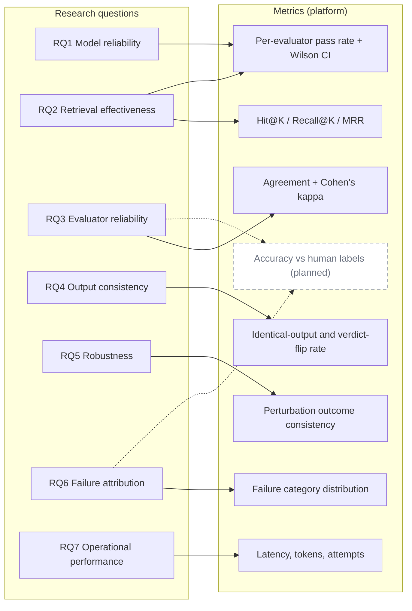
*Figure 1. Research question to metric mapping. Solid arrows: metric implemented [Verified]. Dashed: requires human labels, which do not exist yet (planned).*

| RQ | Candidate hypothesis | Independent variable(s) | Dependent variable(s) | Controlled variables | Method | Measurable outcome | Status |
|---|---|---|---|---|---|---|---|
| RQ1 Model reliability | A 4B model answers more questions correctly than a 1B model under identical retrieval | Generator model | Per-evaluator pass rate | Dataset version, retrieval config, prompt, evaluators, judge | Paired runs on the same questions; exact McNemar test | Discordant-pair counts, p-value | **Tested (EXP-001), not significant**: 35 vs 30 correct, p = 0.27 **[actual]**, and confounded by self-judging |
| RQ2 Retrieval effectiveness | (a) Retrieval improves correctness over closed book; (b) top-3 ≥ top-1 | Retrieval on/off; *k* | Pass rate; correctness given hit vs miss | Model, prompt format, evaluators, corpus | Paired arms; conditional analysis | Δ pass rate, McNemar p | **(a) Supported**: 8 → 35 / 60, p = 4.6e-7. **(b) Not demonstrated**: p = 0.23 **[actual]** |
| RQ3 Evaluator reliability | Exact match underestimates correctness; agreement with the judge is moderate; the judge agrees with humans ≥ X% | Evaluator | Agreement, κ, accuracy vs human | Same answers | Pairwise agreement on identical outputs; human annotation | κ, confusion matrix | κ measured (0.44–0.50 EM vs judge) **[actual]**; human validation **planned** |
| RQ4 Output consistency | T = 0 runs are identical; T = 0.8 changes wording more than verdicts | Temperature, repetition | Identical-output rate, verdict-flip rate | Everything else | Repeated runs of one experiment | Rates per question | **Tested**: 57/60 identical at T = 0; 50/60 identical and 1 verdict flip at T = 0.8 **[actual]** |
| RQ5 Robustness | Paraphrasing questions or reordering context changes verdicts on < 10% of cases | Perturbation type | Outcome consistency | Model, retrieval, evaluators | Baseline/perturbation pairs (`perturbation_of` metadata) | Consistency rate, category transitions | Mechanism **implemented**; real experiment **not yet run** |
| RQ6 Failure attribution | Rule-based categories match human root-cause judgements on ≥ 70% of failed cases | Diagnosis rule set | Agreement with human attribution | Same failed cases | Human annotation of cause | Agreement, κ | Distribution measured **[actual]**; validity **not yet measured** |
| RQ7 Operational performance | Adding retrieved context increases prompt tokens and generation latency roughly with context size | Retrieval, model | Latency (ms), tokens | Hardware, server | Telemetry from provider adapters | Median and p90 | **Measured**: qwen median 119 ms closed vs 350 ms top-3; ~65 vs ~500 tokens **[actual]** |

## 4. System Architecture

### 4.1 High-level architecture

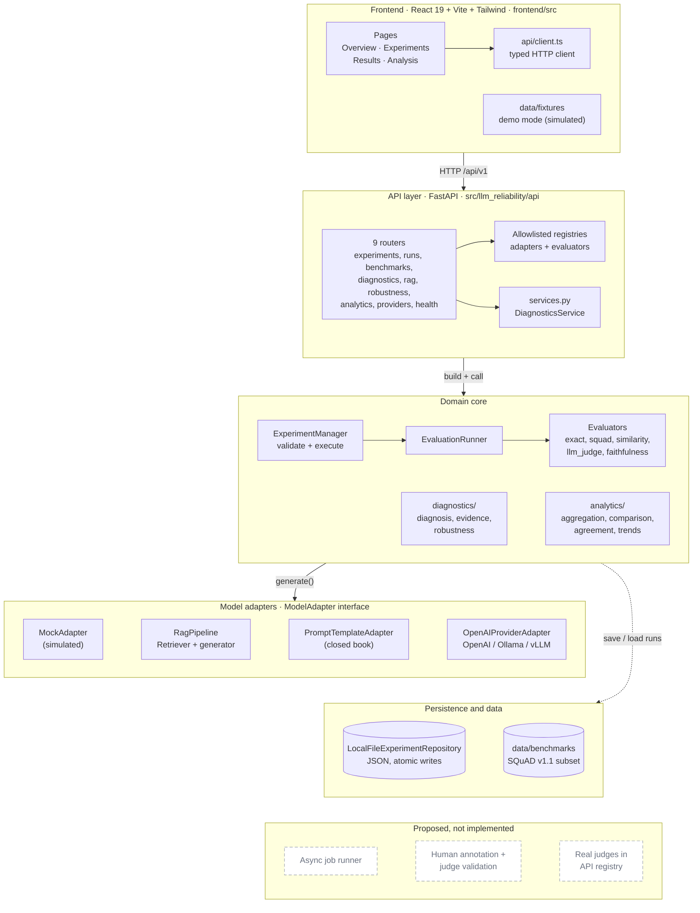
*Figure 2. High-level architecture, one layer per row. Solid boxes are implemented and were exercised in this audit; dashed grey boxes are proposed, not implemented. Arrows show call direction. LLM judges inside the evaluators also call the provider adapters, and study scripts read `data/benchmarks` directly.*

Key interfaces **[Verified]**:

| Interface | File | Contract |
|---|---|---|
| `ModelAdapter.generate(ExecutionRequest) -> ModelResponse` | `evaluation/adapters.py` | The only place the engine touches a model. Mock, RAG, OpenAI and closed-book adapters all implement it. |
| `Evaluator.evaluate(TestCase, ModelResponse) -> EvaluationResult`, `get_config()` | `evaluation/evaluators.py` | Independent, configuration-recording evaluators with an explicit `EvaluationStatus`. |
| `RetrievalEvaluator.evaluate(...) -> RetrievalEvaluationResult` | `rag/evaluators.py` | Kept separate from answer evaluators. The API rejects them as answer evaluators. |
| `EmbeddingModel.embed / embed_one` | `rag/embeddings.py` | Fake, SentenceTransformer and OpenAI-compatible implementations. |
| `ExperimentRepository` (save/load experiment and run, list ids) | `experiments/repository.py` | JSON implementation in `local_repository.py`. A SQLite implementation could replace it. |

### 4.2 Why each component exists

| Component | Why it exists (research purpose) |
|---|---|
| Dataset version + fingerprint | So that "the same questions" is a checkable fact, not an assumption |
| Adapter interface | Generation can be swapped without touching evaluation code, which makes controlled comparisons possible |
| Independent evaluators | Different methods measure different properties and must stay separable (RQ3) |
| Retrieval evaluators kept separate | Retrieval quality and answer quality are separate dimensions (RQ2, RQ6) |
| Diagnostics | Evidence-linked failure attribution (RQ6) |
| Analytics comparison + compatibility | Prevents invalid comparisons (different dataset versions) and labels the kind of comparison |
| Provenance (`adapter_id`, `executed_model_ids`, `simulated_components`) | So a recorded run is what actually ran, and simulated data is never read as real |

## 5. End-to-End Experiment Lifecycle

### 5.1 Lifecycle workflow

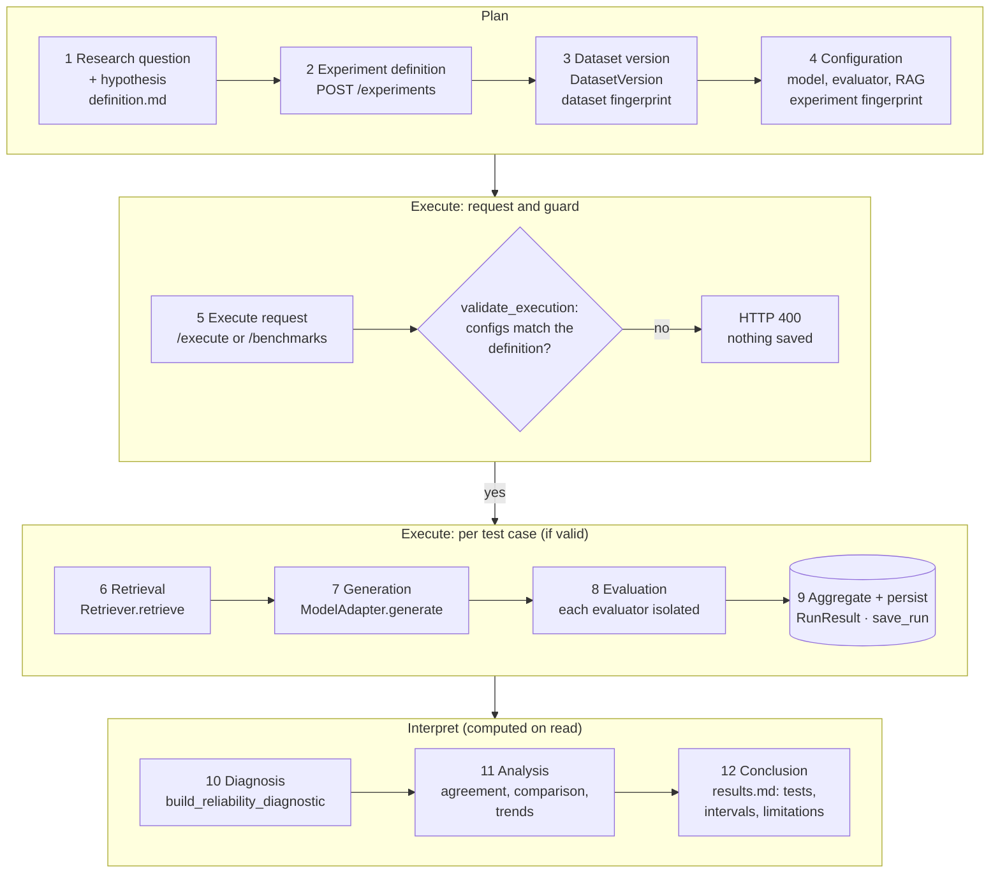
*Figure 3. End-to-end lifecycle, with the implementing file, class or route at each stage. Diagnosis and analysis are computed when results are read, never stored, so improved rules apply to old runs.*

| Stage | What happens | Implementation **[Verified]** |
|---|---|---|
| 1 Research question | RQ, hypothesis, design and threats written *before* running | `research/experiments/EXP-001_local_rag_reliability/definition.md` |
| 2 Definition | Request validated; credential-like keys rejected (422); evaluators built from allowlist; retrieval metrics rejected as answer evaluators (400) | `api/routers/experiments.py:create_experiment`, `api/schemas/common.py:find_credential_keys`, `api/registry.py:EvaluatorRegistry.get` |
| 3 Dataset version | SHA-256 over canonical JSON of all test cases (id, input, reference, metadata) | `experiments/models.py:DatasetVersion`, `experiments/fingerprint.py` |
| 4 Configuration | Fingerprint over dataset version + model config + evaluator configs; re-verified on every load | `ExperimentDefinition`, `ExperimentRun.from_dict` |
| 5 Execution | External adapters need `allow_external_inference`; evaluator configs and RAG pipeline config must equal the definition's | `ExperimentManager.validate_execution`, `_check_rag_config_matches` |
| 6 Retrieval | Query embedded, cosine similarity over chunk vectors, top-*k* | `rag/retriever.py:Retriever.retrieve` |
| 7 Generation | Prompt rendered from a versioned template; provider call with bounded retries; latency and token provenance | `rag/pipeline.py:build_rag_prompt`, `providers/base.py:BaseProviderAdapter.generate` |
| 8 Evaluation | Each evaluator isolated; exceptions become `EXECUTION_ERROR` | `evaluation/runner.py` |
| 9 Aggregation | Execution success (`succeeded`) kept separate from evaluation (`passed`) | `evaluation/models.py:TestCaseResult`, `RunResult` |
| 10 Diagnosis | Retrieval metrics at the run's own *k*; ordered rule list | `api/services.py:DiagnosticsService`, `_run_top_k`, `diagnostics/diagnosis.py` |
| 11 Analysis | Per-evaluator aggregates, κ, run comparison with compatibility classification, trends | `analytics/*`, `GET /api/v1/analytics/*` |
| 12 Conclusion | Paired tests, intervals, limitations | `scripts/analyze_reliability_study.py`, `results.md` |

### 5.2 Backend sequence for one test case

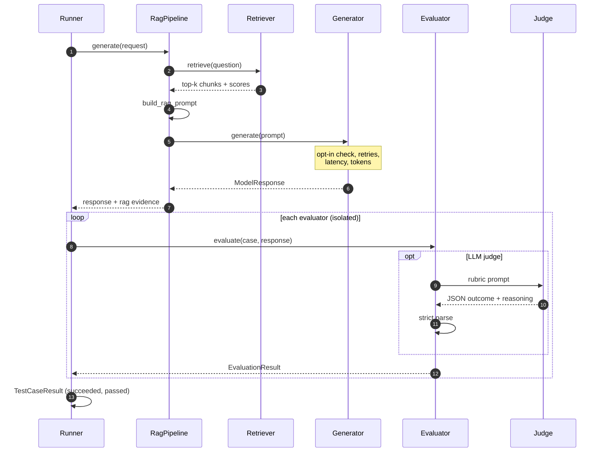
*Figure 4. The execution of one RAG test case (Runner = `EvaluationRunner`, Generator = `OpenAIProviderAdapter`; the Retriever embeds the query with the `EmbeddingModel` before scoring chunks). A judge reply that fails the strict parse becomes `OUTPUT_VALIDATION_ERROR`. An adapter exception ends the case with `execution_error` and no evaluations. An evaluator exception affects only that evaluator's result.*

### 5.3 RAG pipeline data flow

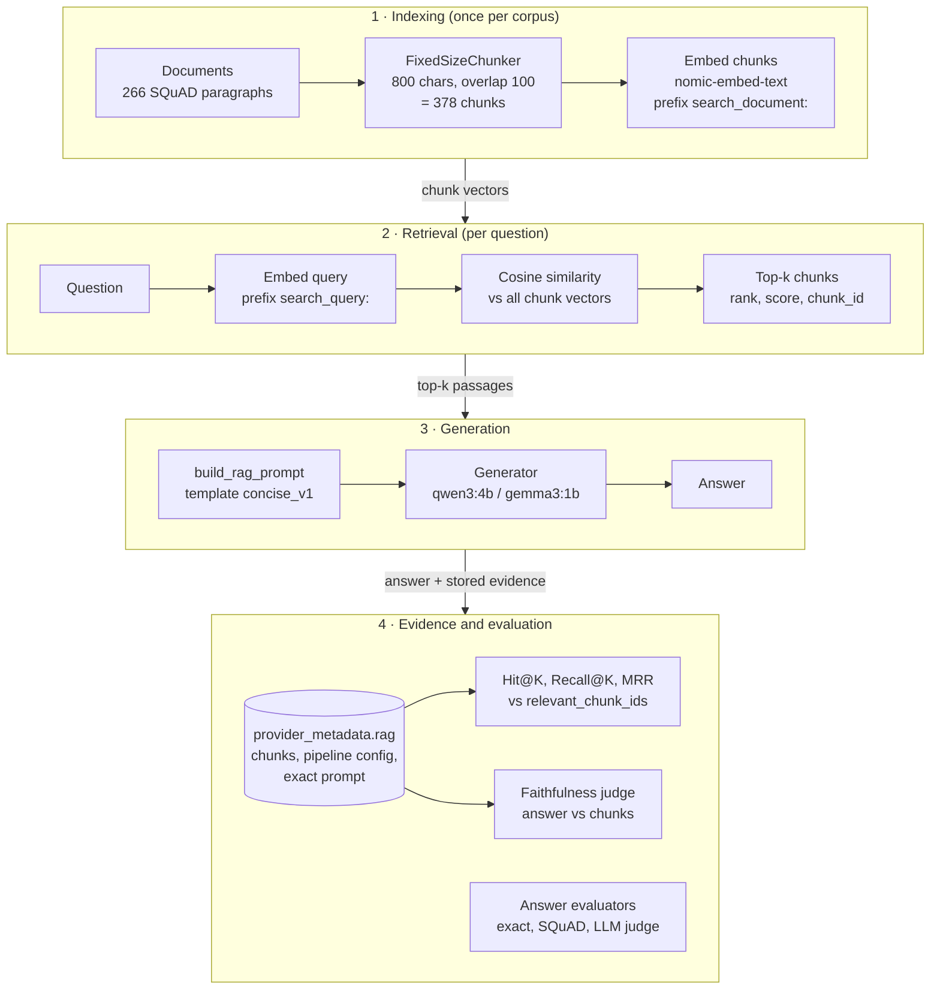
*Figure 5. RAG data flow with the EXP-001 settings. Everything needed to audit a case afterwards is stored in `provider_metadata.rag`: the retrieved chunks and scores, the pipeline config, and the exact prompt.*

## 6. Evaluation Methodology

### 6.1 Three separate correctness dimensions

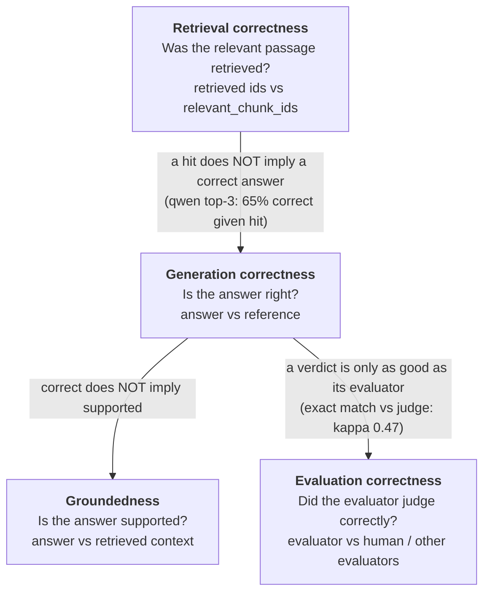
*Figure 6. Why the dimensions are measured separately. The numbers on the edges are actual EXP-001 measurements (qwen3:4b, top-3). Each arrow is an inference that can fail independently.*

### 6.2 Evaluation methods compared

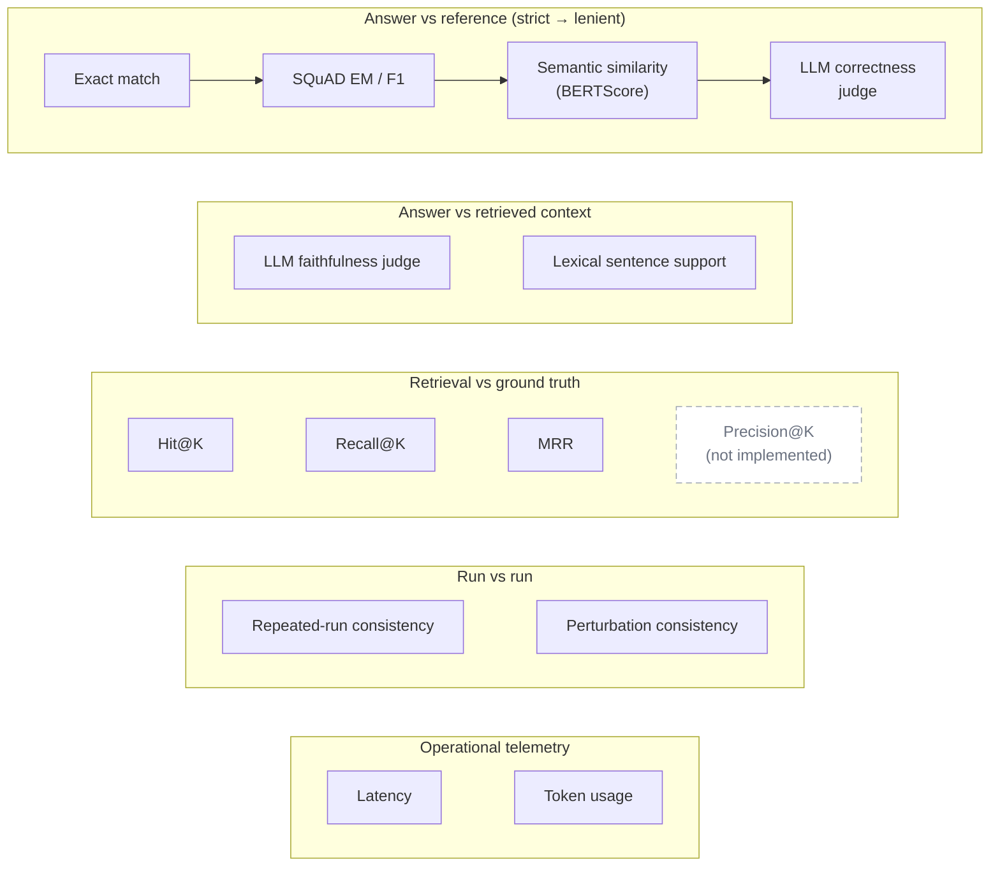
*Figure 7. Evaluation methods grouped by what they compare. The left-to-right chain in the first group goes from strict surface matching to model-based judgement. Dashed: not implemented.*

### 6.3 Metric reference table

| Metric | What it measures | Calculation | Good / poor | Limitations | Implemented in |
|---|---|---|---|---|---|
| **Exact match** | Surface identity with one reference | `normalize(output) == normalize(reference)`, where normalization covers case and whitespace only | 1 = identical text | Rejects correct paraphrases and extra words. In EXP-001 it never passed an answer the judge failed **[actual]**. | `evaluation/evaluators.py:ExactMatchEvaluator`, `normalization.py` |
| **SQuAD EM / F1** | Normalized overlap with *any* gold answer | See formulas below | EM = 1 exact after normalization; F1 near 1 means high token overlap | Lexical; a right span inside a wrong sentence can score high F1 | `evaluation/squad_match.py` |
| **Semantic similarity** | Embedding similarity to the reference | BERTScore F1 ≥ threshold (0.85) | High similarity | Similar ≠ correct (one changed number). **In the API registry the backend is a fake** (string equality) and is labelled simulated. Real BERTScore needs the `semantic` extra and was **not run**. | `evaluation/semantic_similarity.py` |
| **Correctness judge** | Factual agreement with the reference, per a rubric | Judge returns `correct` / `partially_correct` / `incorrect`; pass only for `correct` | Pass = judge says correct | Judge bias; sees only the first gold answer; not validated vs humans | `evaluation/llm_judge.py:LLMJudgeEvaluator` |
| **Faithfulness** | Support of the answer by retrieved context | Judge returns `supported` / `unsupported` / `contradicted` / `undetermined` (`undetermined` → `passed = None`) | `supported` | Labels abstentions `supported` (8/8 in EXP-001) **[actual]** | `rag/faithfulness_judge.py` |
| **Precision@K** | Share of retrieved chunks that are relevant | $\frac{\lvert R \cap T_k\rvert}{k}$ | High = little noise | **Not implemented** **[Verified]** | — |
| **Recall@K** | Share of relevant chunks retrieved | $\frac{\lvert R \cap T_k\rvert}{\lvert R\rvert}$ | 1 = all relevant retrieved | Equals Hit@K when there is one relevant chunk (EXP-001: 59/60 cases) | `rag/evaluators.py:RecallAtKEvaluator` |
| **Hit@K** | Any relevant chunk in the top *k* | $\mathbb{1}[R \cap T_k \neq \emptyset]$ | 1 | Depends on the relevance labelling rule | `rag/evaluators.py:HitAtKEvaluator` |
| **MRR** | How early the first relevant chunk appears | See formula below | 1 = rank 1 | Only first hit counts; 0 if not retrieved | `rag/evaluators.py:MeanReciprocalRankEvaluator`, mean in `rag/summary.py` |
| **Repeated-run consistency** | Stability across identical runs | Share of questions whose normalized outputs are identical across all *R* runs; verdict-flip rate | High at T = 0 | Wording changes can preserve correctness | `scripts/analyze_reliability_study.py`; perturbation consistency in `diagnostics/robustness.py` |
| **Latency** | Time of the successful generation attempt | `perf_counter` around the successful attempt; total incl. retries kept as `total_elapsed_ms` | Low median and p90 | Hardware-specific; cold model loads inflate max | `providers/base.py:BaseProviderAdapter.generate` |
| **Token usage** | Prompt, completion and total tokens | As reported by the provider; `token_source` = `provider_reported` or `unavailable` (never estimated) | Lower cost | Mock adapters report none | `providers/base.py`, `openai_provider.py` |

**Formulas.** Notation: $R$ is the set of relevant chunk ids; $T_k$ is the top-*k* retrieved ids; $Q$ is the question set.

$$\text{MRR} = \frac{1}{|Q|}\sum_{q \in Q} \frac{1}{\text{rank}_q}\quad(\text{term} = 0 \text{ if no relevant chunk is retrieved})$$

$$\text{F1}_{\text{SQuAD}} = \max_{g \in \text{gold}} \frac{2\,P\,R}{P+R},\qquad P = \frac{|\text{pred} \cap g|}{|\text{pred}|},\; R = \frac{|\text{pred} \cap g|}{|g|}\ \text{(token multisets after normalization)}$$

$$\kappa = \frac{p_o - p_e}{1 - p_e},\qquad p_e = p_A\,p_B + (1-p_A)(1-p_B)$$

Here $p_o$ is the observed agreement and $p_A, p_B$ are each evaluator's pass rate (Cohen, 1960).

$$\text{Wilson 95\% interval: }\ \frac{\hat p + \frac{z^2}{2n} \pm z\sqrt{\frac{\hat p(1-\hat p)}{n} + \frac{z^2}{4n^2}}}{1 + \frac{z^2}{n}},\quad z = 1.96$$

The paired comparison uses the exact McNemar test (McNemar, 1947): a two-sided binomial test on the discordant pairs $b$ and $c$, with $p = \min\!\left(1,\ 2\sum_{i=0}^{\min(b,c)}\binom{b+c}{i}2^{-(b+c)}\right)$.

### 6.4 Case-level aggregation policy

`TestCaseResult.passed` **[Verified]** is true only if all of the following hold:

- execution succeeded;
- no evaluator returned `passed = False`;
- no evaluator errored (`EXECUTION_ERROR`, `OUTPUT_VALIDATION_ERROR` or `INVALID_CONFIGURATION`);
- at least one evaluator returned `passed = True`.

`SKIPPED` evaluators are ignored, and missing results are never converted into passes.

The run pass rate is `num_passed / num_test_cases`. Its denominator includes crashed and unscored cases. Because this "any-fail" policy is dominated by the strictest evaluator, the console additionally shows five per-question states: passed, *checks disagree* (two checks of the same criterion disagree), wrong, not scored, and crashed.

### 6.5 Actual measurements: one dataset, three answers to "how accurate?"

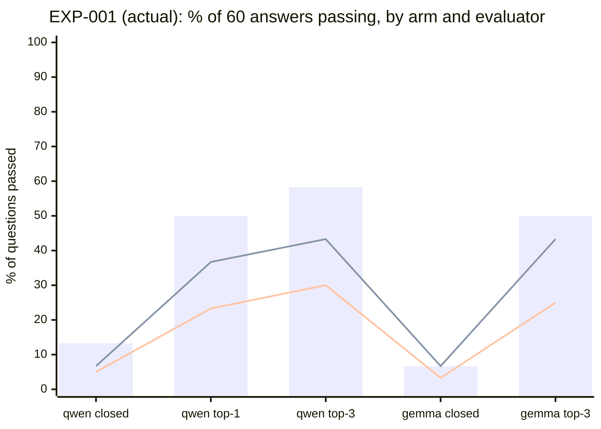
*Figure 8. Actual EXP-001 measurements (n = 60 per arm, first run of each arm). Bars: LLM correctness judge. Upper line: SQuAD EM. Lower line: exact match. The gap between evaluators within one arm is as large as the gap between arms. 95% intervals are about ±12 points; see `results_tables.md`.*

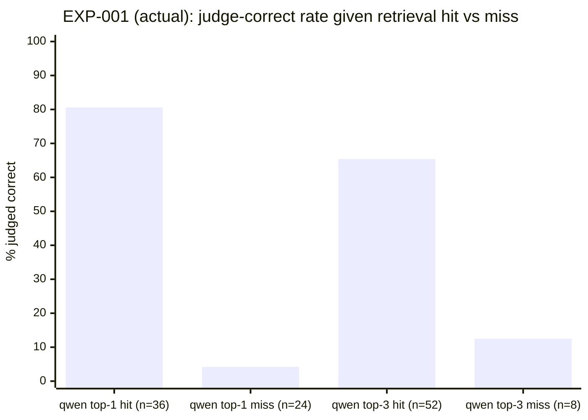
*Figure 9. Correctness conditional on strict retrieval hit (actual). When the source passage is not retrieved, the model is almost never judged correct. The hit groups at k = 1 and k = 3 are different subsets of questions, so they should not be compared with each other.*

## 7. Failure Taxonomy

### 7.1 Classification tree (as implemented)

`diagnostics/diagnosis.py:build_reliability_diagnostic` applies these rules **in order**; the first match becomes the primary category. Every other matching signal is kept in `secondary_findings` **[Verified]**.

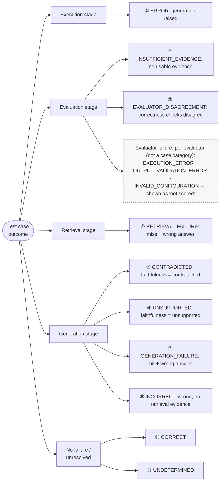
*Figure 10. Failure classification tree grouped by pipeline stage; the circled numbers give the order in which the code tests the rules (first match wins). Retrieval failure precedes the faithfulness labels, so a failure is attributed to the earliest failing pipeline stage (changed in this audit; previously faithfulness came first). Evaluator failures are recorded per evaluator through `EvaluationStatus`, not as a case category.*

### 7.2 Categories with real examples

Examples are **actual EXP-001 cases** unless marked otherwise. "Evidence" is what the platform records; "Inference" is what we may *suspect*. The diagnosis only asserts the evidence.

| Category | Real example | Observable evidence | Diagnostic approach | Limitations |
|---|---|---|---|---|
| **Retrieval failure** | qwen top-1, "Turing machines are commonly employed to define what?" → "A Turing machine is a mathematical model of a general computing machine." (gold: complexity classes) | Hit@1 = 0 (the source chunk was not retrieved); judge: `partially_correct` | Retrieval miss + wrong answer | Strict labels: another passage may contain the answer. The faithfulness judge still said `supported`. |
| **Generation failure** | qwen top-1, "How else might a physician take advantage of self-interest?" → "Sell more medications to the patient" (gold: exaggerating their seriousness) | Hit@1 = 1; judge `partially_correct`; faithfulness `supported` | Retrieval hit + wrong answer | *Inference*, not evidence: the model chose a different span. Arguably the judge could be lenient here. |
| **Incorrect** (no retrieval) | qwen closed-book, same Turing question → "Computable functions" | Judge `partially_correct`; no retrieval evidence | Wrong answer without retrieval | Cannot separate "doesn't know" from "question is under-specified without its paragraph". |
| **Unsupported claim** | gemma top-3, "What do most online pharmacies do?" → "Sell prescription drugs without a prescription." | Faithfulness `unsupported`; judge `incorrect`; retrieval hit (secondary finding: generation_failure) | Faithfulness label | Faithfulness depends on one judge model. |
| **Contradicted** | gemma top-3, "What is the unproven assumption … complexity classes?" → "P = PSPACE" (gold: suspected to be unequal) | Faithfulness `contradicted`; judge `incorrect` | Faithfulness label | Same as above. |
| **Evaluator disagreement** | qwen top-1, "BQP and QMA … what type of Turing machine?" → "quantum Turing machines" (gold: quantum) | Exact match fail, SQuAD fail, judge `correct` | Two correctness evaluators disagree | Fired on 18–22 of 60 cases in RAG arms, mostly correct-but-longer answers **[actual]**. The rule is too coarse when one evaluator is a known-strict formatting check. |
| **Insufficient evidence** | Closed-book arms: faithfulness `SKIPPED` (no context) appears as a *secondary* finding | Evaluator status `skipped` | No usable evidence → category; partial → secondary finding | Not a judgement about the answer. |
| **Evaluator failure** | qwen top-1: faithfulness judge reply cut off at `max_tokens = 200` → "Judge output was not valid JSON: Unterminated string" **[actual]** | `OUTPUT_VALIDATION_ERROR` with raw judge output stored in `details` | Strict parse; never coerced into a verdict | Shown as "not scored", not "wrong". |
| **Execution failure** | API sweep in this audit: `openai-custom` pointed at a closed port → "ProviderConnectionError: OpenAI Connection error" on every case; run status `failed` **[actual, audit probe]** | `execution_error` on the test case; no evaluations | First rule | Retries are recorded (`attempts`); the cause is the provider's message. |

### 7.3 Evidence-based diagnosis vs inferred root cause

| | Evidence-based diagnosis (what the platform does) | Inferred root cause (what a human may conclude) |
|---|---|---|
| Basis | Recorded signals: retrieval hit/miss, evaluator labels, statuses | Reasoning about model internals, data and prompt |
| Example | "Relevant chunk retrieved; answer judged wrong → generation_failure" | "The model was distracted by passage #1" |
| Certainty | Deterministic given the evidence and rules | Hypothesis; needs targeted experiments (e.g. context reordering) |
| Stored | Yes (computed on read from stored evidence) | No; belongs in a failure-analysis document |

## 8. Experimental Design

### 8.1 Checklist for a valid experiment on this platform

1. Write the RQ, hypothesis, variables and threats **before** running (`definition.md`).
2. Fix **one dataset version**. All arms must share `dataset_version.version_id`; the comparison API refuses otherwise.
3. Change **one independent variable** per contrast; keep the prompt template, evaluators and judge identical.
4. Choose evaluators that measure the target criterion. Report each evaluator separately.
5. Decide repetitions. At T = 0, one run per arm plus one repeat to *measure* determinism. At T > 0, ≥ 3 runs.
6. Pre-specify the statistics: paired tests on the same questions, intervals, and the contrasts to be tested.
7. Record the environment: model digests, server version, commit. `run_reliability_study.py` does this.
8. Archive the raw runs and report limitations.

### 8.2 Worked example (actual data): top-1 vs top-3 retrieval

This example uses **actual EXP-001 measurements**; nothing in it is hypothetical.

| Element | Specification |
|---|---|
| Research question | Does giving the model three retrieved passages instead of one change answer correctness? (RQ2) |
| Hypothesis (pre-registered) | H2: top-3 ≥ top-1, with possible distraction by irrelevant passages |
| Independent variable | `top_k` ∈ {1, 3} (`RagPipelineConfig.top_k`) |
| Dependent variables | Judge-correct rate, SQuAD EM/F1, exact match; Hit@k, MRR; abstention rate |
| Controlled variables | Dataset `squad-v1.1-dev-subset-v1` (60 questions, same `relevant_chunk_ids`); corpus of 266 paragraphs → 378 chunks (800/100); `nomic-embed-text` with prefixes; generator `qwen3:4b-instruct` at T = 0, seed 42, `max_tokens = 64`; prompt `concise_v1`; the four evaluators and the judge configuration |
| Baseline | `exp001-qwen-rag-k1` |
| Configurations | `exp001-qwen-rag-k1` vs `exp001-qwen-rag-k3` (same dataset version; the stored definitions differ only in `model_config.extra_params.rag.top_k`, verified by diffing the two JSON files) |
| Repetition | 1 run each at T = 0; the top-3 arm was repeated once to measure determinism (57/60 identical) |
| Statistics | Exact McNemar on paired judge verdicts; Wilson intervals |

**Measurements [actual]:**

| | top-1 | top-3 |
|---|---|---|
| Strict Hit@k | 60.0% | 86.7% |
| MRR | 0.600 | 0.719 |
| Judge correct | 30/60 (50.0%) [37.7, 62.3] | 35/60 (58.3%) [45.7, 69.9] |
| SQuAD EM | 22/60 | 26/60 |
| Abstained ("I don't know") | 23.3% | 10.0% |
| Discordant pairs (judge) | only top-1 correct: 3 | only top-3 correct: 8 |
| Exact McNemar p | 0.23 | |

**Interpretation.**

- Retrieval at *k* = 3 found the source passage far more often (+26.7 points Hit), and the model abstained less.
- Correctness moved in the hypothesised direction (+5 cases net), but with 11 discordant pairs the difference is **not distinguishable from chance** at n = 60.
- The correct conclusion is "not demonstrated", not "no effect".

**Threats to validity.**

- **Measurement.** The judge is the same model as the generator. Strict relevance labels undercount hits. The judge sees one gold answer.
- **Statistical.** Low power. A rough calculation suggests several hundred paired questions would be needed to detect a ~5-point difference.
- **External validity.** One dataset (6 SQuAD articles), one embedding model, one chunking setting, one prompt.

**Limitations.** At T = 0 the server was not fully deterministic, so a single run per arm carries some run-to-run noise (3/60 outputs changed).

## 9. Reproducibility and Data Model

### 9.1 Experiment and result data model

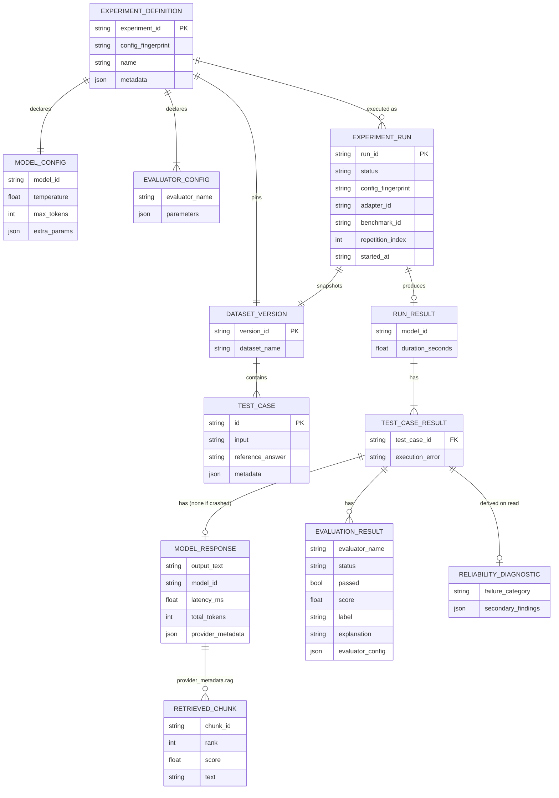
*Figure 11. Logical data model (attribute details: §9.2 and `experiments/models.py`). Physically, an `ExperimentRun` is one JSON file that embeds full snapshots of the dataset version, model config and evaluator configs, so it remains interpretable even if the definition changes. Diagnostics are derived on read and never persisted.*

### 9.2 Reproducibility mechanisms

| Mechanism | How it works | Implemented in | Status |
|---|---|---|---|
| Dataset fingerprint | SHA-256 of canonical JSON (sorted keys) of every test case | `experiments/fingerprint.py:compute_dataset_fingerprint` | **[Verified]** |
| Configuration fingerprint | SHA-256 over dataset version + model config + evaluator configs; recomputed and compared on every load (raises on mismatch) | `compute_experiment_fingerprint`, `ExperimentRun.from_dict` | **[Verified]** |
| Immutable dataset reference | Runs embed the full dataset snapshot, not just its id | `ExperimentRun.dataset_version` | **[Verified]** |
| Execution provenance | `adapter_id`, `executed_model_ids`, `simulated_components` | `experiments/models.py` | **[Verified]**, added in this audit |
| Execution guards | Evaluator configs and RAG config must equal the definition's, otherwise HTTP 400 | `ExperimentManager.validate_execution` | **[Verified]**, added in this audit |
| Corpus fingerprint | SHA-256 of document ids + contents | `rag/pipeline.py:compute_corpus_fingerprint` | **[Verified]** |
| Random seeds | Passed via `extra_params.seed` (forwarded to the provider) | `openai_provider.py` | Recorded only if the experiment sets one |
| Model versioning | Provider-reported `model` and `system_fingerprint`; for Ollama, model **digests** recorded by the study runner | `providers/base.py`; `scripts/run_reliability_study.py:environment_record` | API path does **not** record digests or code commit |
| Atomic persistence | Temp file → `fsync` → `os.replace` | `experiments/local_repository.py` | **[Verified]** (code read) |
| Raw-output archive | All EXP-001 runs in `runs.tar.gz`; clean clone + restore reproduces `results.json` | `research/experiments/EXP-001_.../runs.tar.gz` | **[Verified]** |

### 9.3 Limits of reproducing external model behaviour

- **The same configuration does not mean the same outputs.** EXP-001 at T = 0 with seed 42 on a *local* server reproduced 57/60 outputs **[actual]**. GPU kernels and batching can be nondeterministic.
- **Hosted providers can change the model behind a name** (e.g. `gpt-4o-mini`). The recorded `system_fingerprint` helps detect changes but does not prevent them.
- **Therefore:** archive outputs and treat them as the primary record. Re-running is a *replication* (new measurement), not a reproduction. The runner refuses to append runs to experiments whose recorded model digests differ from the current machine's (`--allow-env-change` to override).

## 10. Current Implementation Audit

### 10.1 How the audit was done

On 2026-11-19 the audit:

- read the source;
- ran the full test suites (backend: **473 passed, 3 skipped**; frontend: **52 passed**);
- ran ruff and mypy (clean);
- did a clean-clone install and test;
- swept every GET route over seeded data, a crashed run and a benchmark (**0 server errors**);
- drove every console page in live and demo modes in headless Firefox (**0 console errors**);
- ran EXP-001 against real local models (540 generations).

Test functions per backend area (`def test_` count):

| Area | Count |
|---|---|
| evaluation | 127 |
| rag | 127 |
| experiments | 70 |
| api | 54 |
| diagnostics | 41 |
| analytics | 29 |
| reliability | 15 |
| providers | 10 |

### 10.2 Capability matrix

| Capability | Status | Evidence (files, tests) | Known limitations |
|---|---|---|---|
| Experiment definition, dataset versioning, fingerprints | **Implemented and verified** | `experiments/models.py`, `fingerprint.py`; `tests/experiments/*` | Code version not recorded by the API path |
| Atomic JSON persistence | **Implemented and verified** | `local_repository.py`; `tests/experiments/test_local_repository.py` | Lists parse every file per request |
| Execution/evaluation separation, explicit evaluator statuses | **Implemented and verified** | `evaluation/models.py`; `tests/evaluation/test_pass_rate_consistency.py` | Any-fail case policy |
| Exact match, SQuAD EM/F1 | **Implemented and verified** | `evaluators.py`, `squad_match.py`; `tests/evaluation/test_squad_match_and_prompting.py` | Lexical only |
| LLM correctness and faithfulness judges (real model) | **Implemented and verified** (study script) | `llm_judge.py`, `faithfulness_judge.py`; EXP-001 | Not selectable as real judges from the API/console (registry uses canned fakes) |
| Semantic similarity (BERTScore) | **Implemented but not independently verified** | `semantic_similarity.py:BertScoreBackend`; integration test skipped | API registry uses a fake backend (labelled simulated) |
| Retrieval: chunking, embeddings, cosine top-k | **Implemented and verified** | `rag/*`; EXP-001 with `nomic-embed-text` | Fixed-size chunking only |
| SentenceTransformer embeddings | **Implemented but not independently verified** | `rag/embeddings.py`; opt-in test skipped | Heavy dependency |
| Hit@K, Recall@K, MRR | **Implemented and verified** | `rag/evaluators.py`; `tests/rag/*` | Depend on relevance labels |
| Precision@K, graded context relevance, answer relevance | **Not implemented** | — | — |
| Faithfulness via NLI / claim extraction | **Not implemented** | `diagnostics/evidence.py` is sentence-level lexical only | — |
| Failure diagnosis and taxonomy | **Implemented and verified** | `diagnostics/diagnosis.py`; `tests/diagnostics/test_diagnosis.py` | Validity vs humans unknown; disagreement rule too coarse |
| Robustness pairs (6 perturbation types) | **Partially implemented** | `diagnostics/robustness.py`; demo dataset has one `question_rewording` pair | No perturbation generator; no real robustness experiment yet |
| Repeated-run consistency | **Implemented and verified** (analysis script) | `scripts/analyze_reliability_study.py`; EXP-001 | Not exposed as an API metric |
| Evaluator agreement + Cohen's κ | **Implemented and verified** | `analytics/agreement.py`; `tests/analytics/test_agreement.py`; API + console panel | No human reference |
| Run comparison with compatibility classification | **Implemented and verified** | `analytics/comparison.py`; console "Pick two runs" | Two runs at a time in the UI |
| Benchmarks (adapters × repetitions) | **Implemented and verified** | `api/routers/benchmarks.py`; `tests/api/test_benchmarks.py` | Synchronous HTTP |
| OpenAI-compatible local models (Ollama) | **Implemented and verified** | `openai_provider.py` (`use_request_model`); API run verified against Ollama | Base URL from process environment only |
| Hosted OpenAI API (gpt-4o-mini, gpt-4o) | **Implemented but not independently verified** | Offline tests with a fake client (`tests/providers/test_openai_provider.py`) | No real API call made |
| Credential protection | **Implemented and verified** | `api/schemas/common.py:find_credential_keys`; tests | Key-name heuristic |
| Simulated-data labelling | **Implemented and verified** | `ExperimentRun.simulated_components`; `frontend/src/components/SimulatedNotice.tsx` | Relies on fakes marking themselves |
| Research console (4 sections) | **Implemented and verified** | `frontend/src/pages/*`; 52 Vitest tests; browser pass | Fixtures regenerate with random ids |
| Async execution / job queue | **Planned** | Roadmap only | — |
| Human annotation and judge validation | **Planned** | `per_case.csv` has empty `human_correct` column | — |
| Authentication / multi-user | **Not implemented** | — | Local research tool |
| Teammates' unpushed work, behaviour on Windows/macOS | **Unknown** | Not inspectable from this repository | — |

### 10.3 Defects found and fixed during this audit

The audit found 13 defects. An independent code review of the fixes found 4 more. Checking the live console with real EXP-001 data found 2 more: per-question latency and tokens were dropped by the API, and verbose-but-correct answers were shown as "Wrong". All were fixed with regression tests. The most consequential:

1. **The fake judge's replies violated the parser contract.** Every faithfulness result was a validation error, so every RAG case failed (0/7).
2. **Runs recorded the declared model, not the adapter that ran.** A mock run could be stored as "gpt-4o-mini".
3. **Different adapters were labelled "identical configuration … stochasticity".**
4. **Retrieval was scored at a fixed K = 1.** A *k* comparison could never show a difference.
5. **A top-2 experiment could run on the top-1 pipeline.**
6. **Kappa never reached the API response.**

Full list of the 13 audit defects (the commit history has the details for each):

| # | Defect | Effect |
|---|---|---|
| 1 | Fake judge replies used `{verdict, explanation}`; the parser requires `{outcome, reasoning}` | Every faithfulness result was a validation error, so every RAG case "failed" (0/7) |
| 2 | `create_app(settings)` ignored settings in route dependencies | Each test run wrote junk experiments into `./experiments` (how the 31 junk files appeared) |
| 3 | Retrieval metrics accepted as answer evaluators | Execution persisted a run, then the API returned HTTP 500 |
| 4 | Runs recorded only the experiment's declared model | A mock run could be stored as "gpt-4o-mini"; benchmark runs were indistinguishable |
| 5 | The OpenAI adapter sent the experiment label as the model name | `openai-gpt-4o-mini` would have called a model named after the experiment |
| 6 | Same fingerprint but different adapters compared as "identical configuration … stochasticity" | Model comparisons were mislabelled as repeat trials |
| 7 | Retrieval scored at fixed K=1 | A top-1 vs top-2 comparison could never show a retrieval difference |
| 8 | A top-2 experiment could run on the top-1 pipeline (the UI default) | The run's recorded config did not produce it |
| 9 | Evaluators matched by name only at execution | A fake and a real judge could be swapped silently |
| 10 | Secrets in `extra_params` persisted to disk | Violated the no-secrets rule (redacted only in responses) |
| 11 | Latency included retry back-off sleeps | Biased RQ7 measurements |
| 12 | Diagnosis precedence (section F) | Downstream symptom labelled as the cause |
| 13 | Housekeeping | `openai` missing from dependencies; mypy not installed; 23 ruff errors; plain `pytest` / `npm test` failed; stray stores and a machine-specific script |

## 11. Research Landscape and Related Work

### 11.1 Comparison matrix

| System / work | Purpose | Evaluation methods | Strengths | Limitations (relative to our aims) | Relevance to this project |
|---|---|---|---|---|---|
| **RAGAS** (Es et al., 2023; docs) | Reference-free RAG evaluation with LLMs | Faithfulness, answer/response relevancy, context precision, context recall, noise sensitivity (docs) | Ready-made RAG metrics; widely used | Metrics are LLM-judged; validity depends on the judge; it is a metric library, not an experiment-provenance system | Source of metric definitions we lack (context precision/recall); a candidate external baseline evaluator |
| **ARES** (Saad-Falcon et al., 2023) | Automated RAG evaluation with trained judges | Fine-tuned lightweight judges for context relevance, faithfulness and answer relevance, calibrated with a small human-annotated set via prediction-powered inference | Explicitly combines judges with human labels for confidence intervals | Requires training judges | **Most relevant methodology** for our RQ3: judge + small human set + intervals |
| **TruLens** (docs) | Tracing and feedback functions for LLM apps | "RAG triad": context relevance, groundedness, answer relevance | Observability + evaluation in one tool | Product-oriented; feedback functions are LLM-judged | Same three dimensions as our Figure 6 separation |
| **DeepEval** (GitHub README) | Pytest-like unit testing for LLM apps | Many metrics incl. G-Eval-style LLM-as-a-judge, RAG and agent metrics | Developer workflow, CI integration | Test-pass orientation rather than experimental design | Pattern for evaluator-as-test; not a research record |
| **MLflow** (docs, README) | Experiment tracking, evaluation, tracing for ML/LLM | Built-in and LLM-judge metrics; run tracking | Mature tracking and lineage | General-purpose; RAG failure attribution is not its focus | Our fingerprint/run model plays the role of MLflow tracking at small scale |
| **HELM** (Liang et al., 2022) | Holistic, standardised evaluation of LMs | Many scenarios × metrics (accuracy, calibration, robustness, fairness, efficiency, …) | Breadth, transparency, reproducible framework | Model-centric benchmarks, not application pipelines | Methodological model for multi-metric reporting |
| **OpenAI Evals** (GitHub) | Framework and registry of evals | Templated evals incl. model-graded | Simple to extend | Tied to model-graded patterns | Comparable eval-as-config idea |
| **RGB** (Chen et al., 2023) | Benchmark of RAG abilities | Noise robustness, negative rejection, information integration, counterfactual robustness | Targets RAG-specific failure modes | Fixed benchmark | "Negative rejection" = our abstention finding; design source for RQ5 |
| **LLM-as-a-judge** (Zheng et al., 2023; Wang et al., 2023; Panickssery et al., 2024; G-Eval, Liu et al., 2023) | Using LLMs as evaluators | Pairwise/single grading; CoT + form filling | Scales human-like judgement | Position, verbosity and self-preference biases | Direct threats in EXP-001 (self-judging) |
| **Faithfulness / hallucination** (Ji et al., 2022; FActScore, Min et al., 2023) | Defining and measuring unsupported content | Intrinsic/extrinsic taxonomy; atomic-fact precision | Fine-grained | Claim extraction needs NLU | Upgrade path from sentence-level lexical evidence |
| **Contamination** (Sainz et al., 2023; Golchin & Surdeanu, 2023) | Detecting benchmark leakage | Membership/guided-instruction tests | Raises validity concerns | — | Why EXP-001 includes closed-book arms |

### 11.2 What we provide, adopt, extend, and where a contribution could be

| | |
|---|---|
| **Already provides [Verified]** | An evidence-preserving run record (prompt, chunks, every verdict, configuration snapshot, provenance); execution/evaluation separation; refusal to record mismatched configurations; simulated-data labelling; compatibility-aware comparison; κ reporting |
| **Adopts** | SQuAD normalization and F1 (Rajpurkar et al., 2016); IR metrics (Manning et al., 2008); LLM-as-a-judge rubrics (Zheng et al., 2023); the RAG triad dimensions (TruLens/RAGAS); answer-containment retrieval accuracy (DPR, Karpukhin et al., 2020); Cohen's κ, Wilson intervals, McNemar test |
| **Extends** | Ordered, evidence-only failure attribution with secondary findings; execution-time guards linking recorded configuration to what ran |
| **Possible defensible contribution [Recommendation]** | An empirical study, on small controlled local-model experiments, of **how evaluator choice and evaluator validity change RAG reliability conclusions and failure attributions**, validated against human labels. EXP-001 already shows a 28-point evaluator effect. Novelty must be argued from the *study design and findings*, not from the tooling: RAGAS, ARES, TruLens and DeepEval already provide RAG metrics and judges. |

## 12. Architecture and Methodological Risks

Ranked by how directly each risk could invalidate a research conclusion.

| # | Severity | Area | Risk | How it could compromise conclusions | Mitigation |
|---|---|---|---|---|---|
| 1 | **Critical** | LLM-as-a-judge reliability | Judge accuracy unknown (no human labels); self-judging in EXP-001 | Every "correct" rate and model comparison inherits judge error and bias | Human annotation of ≥ 100 answers; neutral judge; report judge-vs-human κ |
| 2 | **Critical** | Evaluation correctness | Faithfulness rubric labels abstentions `supported` | Faithfulness rates inflated, especially for models that abstain often | Rubric v2 with `no_claim`; re-judge stored outputs |
| 3 | **High** | Statistical validity | n = 60 per arm; 8 tests without correction | Small effects are undetectable; false positives possible | Power planning; pre-registered contrasts; correction or Bayesian estimates |
| 4 | **High** | Metric definitions | Any-fail case verdict and the diagnosis "disagreement" rule are dominated by exact match | Headline pass rate and category counts reflect formatting, not correctness | Declare a primary correctness evaluator per experiment |
| 5 | **High** | Retrieval/generation separation | Strict relevance labels (source paragraph only) | Some generation failures may really be label artefacts, and vice versa | Report strict and lenient; graded relevance labels |
| 6 | **Medium** | Data integrity | Fakes must self-mark to be labelled simulated | A new fake without markers would be read as real | Test that every registry fake sets a marker |
| 7 | **Medium** | Reproducibility | API runs do not record code commit or model digests; T = 0 is not deterministic | A rerun may be attributed to the wrong environment | Record environment per run in the API; archive outputs |
| 8 | **Medium** | Model-provider variability | Hosted models change behind stable names | Longitudinal comparisons confounded | Record `system_fingerprint`; prefer pinned local models for core studies |
| 9 | **Medium** | API/frontend consistency | The client maps some fields by hand (`frontend/src/api/client.ts`) | Fields can be silently dropped, as happened with kappa and telemetry | Generate types from OpenAPI, or add contract tests per endpoint |
| 10 | **Low–Medium** | Scalability | JSON files parsed per list request; synchronous execution | UI slows with thousands of runs; long runs block a request | SQLite repository; background jobs |
| 11 | **Low** | Security | Local tool without auth; credential detection by key name | Secrets under unusual key names could be persisted | Server-side provider config only; deny `extra_params` keys outside an allowlist |

## 13. Visual System Understanding (Figure Index)

| # | Required diagram | Where |
|---|---|---|
| 1 | High-level system architecture | Figure 2 (§4.1) |
| 2 | End-to-end experimental lifecycle | Figure 3 (§5.1) |
| 3 | Backend sequence for a single test case | Figure 4 (§5.2) |
| 4 | RAG pipeline data flow | Figure 5 (§5.3) |
| 5 | Evaluation methodology comparison | Figures 6 and 7 (§6.1–6.2) |
| 6 | Failure taxonomy tree | Figure 10 (§7.1) |
| 7 | Experiment and result data model | Figure 11 (§9.1) |
| 8 | Research question-to-metric mapping | Figure 1 (§3) |
| 9 | Current implementation vs proposed capabilities | Figure 12 (below) |
| 10 | Four-to-five-month roadmap | Figure 13 (§14) |
| — | Actual EXP-001 charts | Figures 8 and 9 (§6.5) |

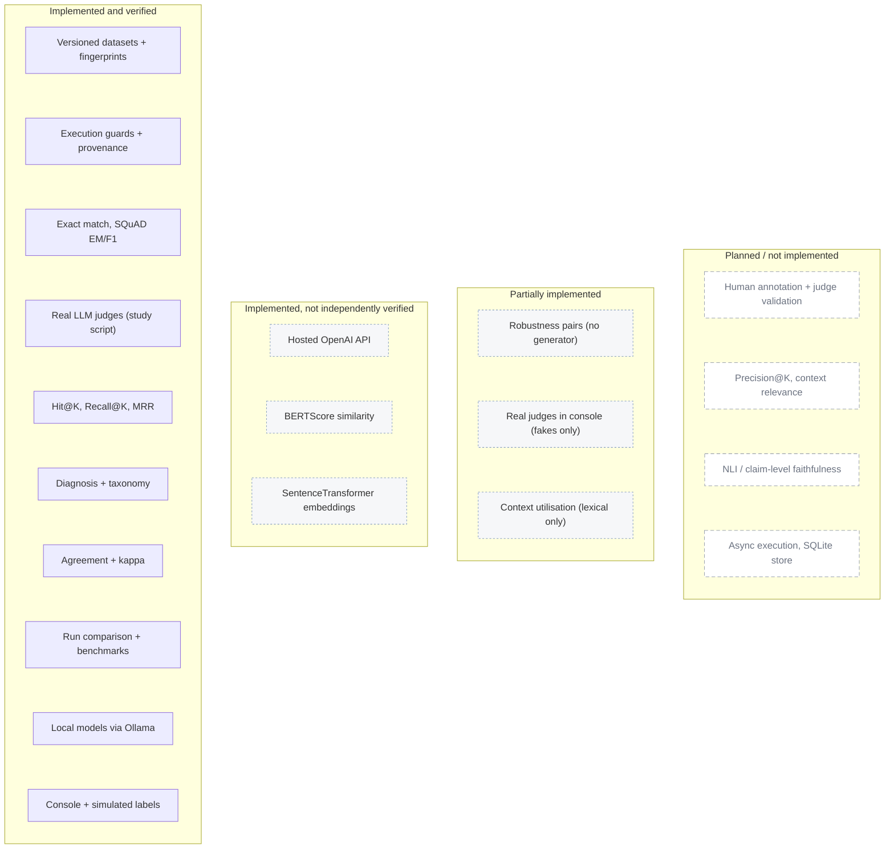
*Figure 12. Implemented vs proposed capabilities. The status of each item and its evidence are in the §10.2 matrix.*

## 14. Project Roadmap

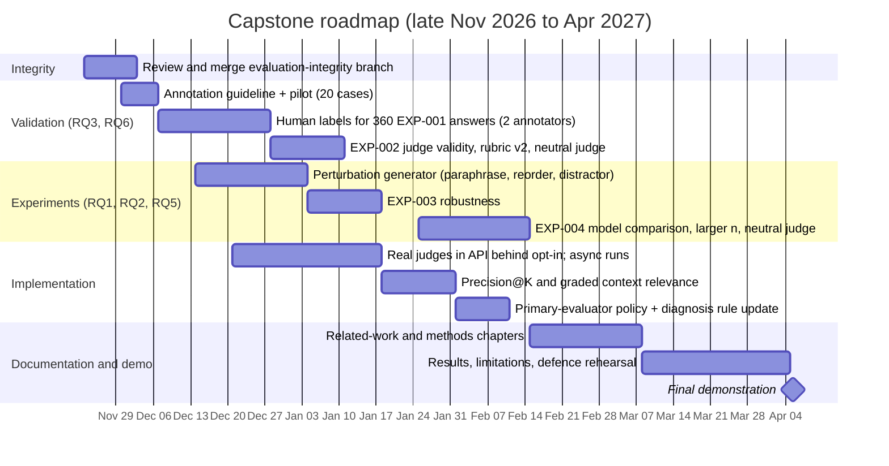
*Figure 13. Proposed roadmap [Recommendation]. Validation work (human labels) starts first because every later conclusion depends on evaluator validity.*

| Milestone | Deliverable | Depends on | Risk | Measurable acceptance criterion |
|---|---|---|---|---|
| M1 Integrity merged (early Dec) | `fix/evaluation-integrity` merged after team review | Team review | Teammates' local data needs reseeding | CI-equivalent: all tests, ruff, mypy, frontend build pass on `main` |
| M2 Human labels (end Dec) | 360 labelled answers, guideline | M1 | Annotator time | Inter-annotator κ ≥ 0.6 on a double-labelled 20% sample |
| M3 EXP-002 judge validity (mid Jan) | Judge/SQuAD/EM accuracy vs humans; rubric v2 | M2 | Judge prompt sensitivity | Report with CIs; rubric v2 handles abstentions (0 abstentions labelled `supported`) |
| M4 Robustness (late Jan) | Perturbation generator + EXP-003 | Generator | Paraphrase quality | ≥ 3 perturbation types, ≥ 100 pairs, consistency rate with CI |
| M5 Platform (mid Feb) | Real judges in API (opt-in), async runs, Precision@K | M1 | Scope creep | A 60-question real run started from the console without blocking |
| M6 EXP-004 (mid Feb) | Model comparison with neutral judge, n ≥ 200 | M3, M5 | Compute time | Pre-registered contrasts; power statement |
| M7 Report + demo (Apr) | Final report, defence | All | Over-claiming | Every claim cites a run, test or reference |

## 15. Final Technical Understanding

**What the platform currently does [Verified].**

- Defines versioned experiments.
- Executes them against mock, RAG and real local or OpenAI-compatible models.
- Evaluates each answer with independent evaluators: exact match, SQuAD EM/F1, LLM correctness and faithfulness judges, and Hit/Recall/MRR for retrieval.
- Keeps all evidence and provenance, and refuses to record mismatched configurations.
- Diagnoses failures with ordered evidence rules.
- Measures evaluator agreement (κ) and compares runs with compatibility checks.
- Presents all of this in a console that labels simulated data.

**What it does not yet do.**

- Validate any evaluator against human judgement.
- Offer real judges or asynchronous runs from the console.
- Generate perturbations.
- Compute Precision@K, graded context relevance, or claim-level faithfulness.
- Record environment provenance for API-initiated runs.

**Strongest possible research contribution [Recommendation].** A controlled, human-validated study of how evaluator choice and evaluator validity change RAG reliability conclusions and failure attributions, using the platform's evidence-preserving records. It is not a claim of a new framework.

**Five concepts to understand deeply.**

1. Execution success vs evaluation verdicts, and the case aggregation policy (§6.4).
2. Retrieval metrics and why relevance labelling decides them (§2.3, Figure 9).
3. LLM-as-a-judge and its biases; why κ and human validation matter (§2.6).
4. Paired experimental design: one variable, the same questions, McNemar test, intervals and power (§8).
5. Configuration fingerprints vs execution determinism (§9).

**Five most important experiments.**

1. Judge validity vs humans (EXP-002).
2. Faithfulness rubric v2, re-judging stored outputs.
3. Retrieval depth with adequate power.
4. Robustness to paraphrase, context order and distractors.
5. Model comparison with a neutral judge.

**Most critical remaining engineering problems.**

- Real judges behind the external-inference opt-in in the API.
- Asynchronous execution.
- Environment provenance on API runs.
- Generated API/frontend types, so fields cannot be silently dropped.
- A primary-evaluator policy.

**Prioritised next step [Recommendation].** Start human annotation of the EXP-001 answers this week (`per_case.csv`, columns `human_correct` and `human_notes`). It is cheap, needs no new code, and every later conclusion depends on it.

---

## Glossary

| Term | Meaning |
|---|---|
| Adapter | Component that turns an `ExecutionRequest` into a `ModelResponse` (mock, RAG pipeline, provider) |
| Abstention | The model declines to answer ("I don't know") |
| Any-fail policy | A case passes only if no evaluator fails or errors and at least one passes |
| BERTScore | Similarity of two texts from contextual token embeddings (Zhang et al., 2019) |
| Chunk | A fixed-size slice of a document used as the retrieval unit |
| Closed book | Answering without retrieved context |
| Cohen's κ | Agreement between two raters corrected for chance |
| Configuration fingerprint | SHA-256 hash identifying dataset version + model config + evaluator configs |
| Contamination | Test data present in a model's training data |
| Dataset version | Content-addressed (hashed) snapshot of all test cases |
| Exact McNemar test | Paired test on cases where two conditions disagree |
| Faithfulness | The answer's claims are supported by the provided context |
| Hit@K / Recall@K / MRR | Retrieval metrics (§6.3) |
| LLM-as-a-judge | Using an LLM to grade outputs against a rubric |
| Paired design | Both conditions answer the same questions, enabling per-question comparison |
| Provenance | Record of what actually executed (adapter, reported model, environment) |
| RAG | Retrieval-augmented generation |
| Simulated component | A fake (mock model, canned judge, fake embeddings) flagged so its output is never read as real |
| SQuAD EM/F1 | Normalized exact match and token-overlap F1 against any gold answer |
| Wilson interval | Confidence interval for a proportion that behaves well at small n |

## References

Papers (arXiv identifiers verified against the arXiv API on 2026-11-19):

1. Chen, J., Lin, H., Han, X., Sun, L. (2023). *Benchmarking Large Language Models in Retrieval-Augmented Generation.* AAAI (2024). arXiv:2309.01431. https://arxiv.org/abs/2309.01431
2. Cohen, J. (1960). A coefficient of agreement for nominal scales. *Educational and Psychological Measurement*, 20(1), 37–46.
3. Es, S., James, J., Espinosa-Anke, L., Schockaert, S. (2023). *Ragas: Automated Evaluation of Retrieval Augmented Generation.* arXiv:2309.15217. https://arxiv.org/abs/2309.15217
4. Gao, Y. et al. (2023). *Retrieval-Augmented Generation for Large Language Models: A Survey.* arXiv:2312.10997. https://arxiv.org/abs/2312.10997
5. Golchin, S., Surdeanu, M. (2023). *Time Travel in LLMs: Tracing Data Contamination in Large Language Models.* ICLR (2024). arXiv:2308.08493. https://arxiv.org/abs/2308.08493
6. Ji, Z. et al. (2022). *Survey of Hallucination in Natural Language Generation.* ACM Computing Surveys. arXiv:2202.03629. https://arxiv.org/abs/2202.03629
7. Karpukhin, V. et al. (2020). *Dense Passage Retrieval for Open-Domain Question Answering.* EMNLP. arXiv:2004.04906. https://arxiv.org/abs/2004.04906
8. Landis, J. R., Koch, G. G. (1977). The measurement of observer agreement for categorical data. *Biometrics*, 33(1), 159–174.
9. Lewis, P. et al. (2020). *Retrieval-Augmented Generation for Knowledge-Intensive NLP Tasks.* NeurIPS. arXiv:2005.11401. https://arxiv.org/abs/2005.11401
10. Liang, P. et al. (2022). *Holistic Evaluation of Language Models.* TMLR (2023). arXiv:2211.09110. https://arxiv.org/abs/2211.09110
11. Liu, N. F. et al. (2023). *Lost in the Middle: How Language Models Use Long Contexts.* TACL (2024). arXiv:2307.03172. https://arxiv.org/abs/2307.03172
12. Liu, Y. et al. (2023). *G-Eval: NLG Evaluation using GPT-4 with Better Human Alignment.* arXiv:2303.16634. https://arxiv.org/abs/2303.16634
13. Manning, C. D., Raghavan, P., Schütze, H. (2008). *Introduction to Information Retrieval.* Cambridge University Press.
14. McNemar, Q. (1947). Note on the sampling error of the difference between correlated proportions or percentages. *Psychometrika*, 12(2), 153–157.
15. Min, S. et al. (2023). *FActScore: Fine-grained Atomic Evaluation of Factual Precision in Long Form Text Generation.* EMNLP. arXiv:2305.14251. https://arxiv.org/abs/2305.14251
16. Nussbaum, Z., Morris, J. X., Duderstadt, B., Mulyar, A. (2024). *Nomic Embed: Training a Reproducible Long Context Text Embedder.* TMLR. arXiv:2402.01613. https://arxiv.org/abs/2402.01613
17. Panickssery, A., Bowman, S. R., Feng, S. (2024). *LLM Evaluators Recognize and Favor Their Own Generations.* arXiv:2404.13076. https://arxiv.org/abs/2404.13076
18. Pineau, J. et al. (2021). *Improving Reproducibility in Machine Learning Research (A Report from the NeurIPS 2019 Reproducibility Program).* JMLR. arXiv:2003.12206. https://arxiv.org/abs/2003.12206
19. Rajpurkar, P., Zhang, J., Lopyrev, K., Liang, P. (2016). *SQuAD: 100,000+ Questions for Machine Comprehension of Text.* EMNLP. arXiv:1606.05250. https://arxiv.org/abs/1606.05250
20. Ribeiro, M. T., Wu, T., Guestrin, C., Singh, S. (2020). *Beyond Accuracy: Behavioral Testing of NLP Models with CheckList.* ACL. arXiv:2005.04118. https://arxiv.org/abs/2005.04118
21. Saad-Falcon, J., Khattab, O., Potts, C., Zaharia, M. (2023). *ARES: An Automated Evaluation Framework for Retrieval-Augmented Generation Systems.* NAACL (2024). arXiv:2311.09476. https://arxiv.org/abs/2311.09476
22. Sainz, O. et al. (2023). *NLP Evaluation in trouble: On the Need to Measure LLM Data Contamination for each Benchmark.* Findings of EMNLP (2024). arXiv:2310.18018. https://arxiv.org/abs/2310.18018
23. Wang, P. et al. (2023). *Large Language Models are not Fair Evaluators.* arXiv:2305.17926. https://arxiv.org/abs/2305.17926
24. Wilson, E. B. (1927). Probable inference, the law of succession, and statistical inference. *JASA*, 22(158), 209–212.
25. Zhang, T., Kishore, V., Wu, F., Weinberger, K. Q., Artzi, Y. (2019). *BERTScore: Evaluating Text Generation with BERT.* ICLR (2020). arXiv:1904.09675. https://arxiv.org/abs/1904.09675
26. Zheng, L. et al. (2023). *Judging LLM-as-a-Judge with MT-Bench and Chatbot Arena.* NeurIPS Datasets and Benchmarks. arXiv:2306.05685. https://arxiv.org/abs/2306.05685

Official documentation and repositories (URLs checked 2026-11-19):

27. RAGAS documentation, available metrics. https://docs.ragas.io/ · https://github.com/explodinggradients/ragas
28. TruLens, "RAG Triad". https://www.trulens.org/getting_started/core_concepts/rag_triad/ · https://github.com/truera/trulens
29. DeepEval. https://deepeval.com/docs/getting-started · https://github.com/confident-ai/deepeval
30. MLflow GenAI evaluation. https://mlflow.org/docs/latest/genai/eval-monitor/ · https://github.com/mlflow/mlflow
31. HELM. https://crfm.stanford.edu/helm/ · https://github.com/stanford-crfm/helm
32. OpenAI Evals. https://github.com/openai/evals
33. SQuAD dataset site. https://rajpurkar.github.io/SQuAD-explorer/
34. Ollama. https://ollama.com

Project sources cited: `src/llm_reliability/**`, `tests/**`, `scripts/run_reliability_study.py`, `scripts/analyze_reliability_study.py`, `research/experiments/EXP-001_local_rag_reliability/` (`definition.md`, `results.md`, `results_tables.md`, `failure_analysis.md`, `per_case.csv`, `runs.tar.gz`).
